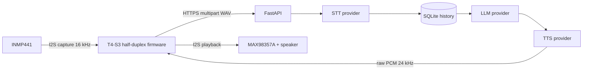

# Architecture

`VoiceProvider` is the service boundary for transcription, chat completion, and speech synthesis. `MockProvider` is deterministic and offline. `OpenAIProvider` uses the official OpenAI Python SDK, with provider keys kept on the server. The API owns validation and conversation orchestration; firmware has no provider-specific logic. Wake word, VAD, streaming capture, interruption handling and acoustic echo cancellation are follow-on work.
