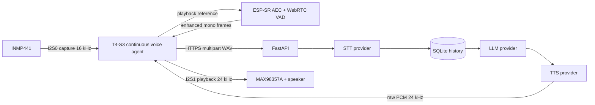

# Architecture

`VoiceProvider` is the service boundary for transcription, chat completion, and speech synthesis. `MockProvider` is deterministic and offline. `OpenAIProvider` uses the official OpenAI Python SDK, with provider keys kept on the server. The API owns validation and conversation orchestration; firmware has no provider-specific logic. OpenAI currently schedules its standalone Speech API models for shutdown on 2027-01-06, so plan to replace that provider adapter before then.

At power-up the firmware creates the audio front end and launches a listener task plus a network/playback worker. The listener retains a short pre-roll, starts a phrase on VAD speech, finalizes after the configured silence, and uses a bounded double buffer so it can keep monitoring while a turn is processed. Playback continues over a separate I2S port. The playback PCM is resampled as the AFE reference channel for full-duplex echo cancellation. Sustained VAD speech during playback requests cancellation of the streamed output and is queued as the next utterance. Conversation ID stays in the client RAM across turns. No wake word or physical activation is required.
